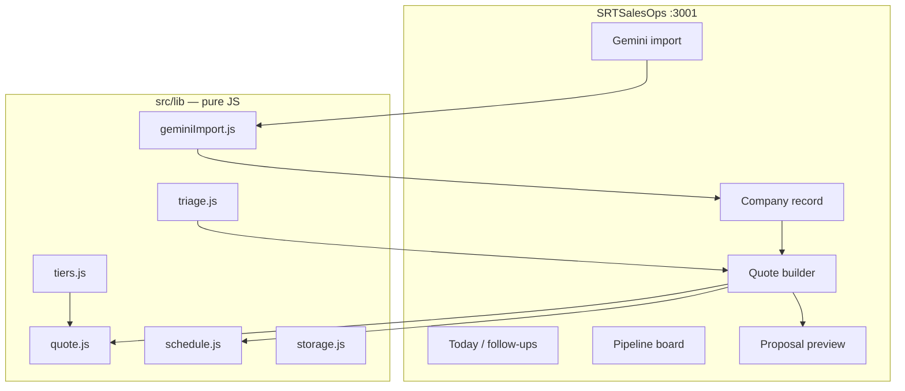

# SRTSalesOps — Build Plan

**Status:** Spec ready. App not scaffolded yet. Remy is paused (credits).  
**Repo:** `/Users/pierrei/StartRightTutoringLocal/SRTSalesOps` (standalone — not inside WebsiteNewLocal)  
**Owner:** Pierre Ingram · `pingram@startrighttutoring.com` (Google Workspace)  
**Brand name everywhere:** Start Right Tutoring (never “Start Right” alone)  
**Date:** 2026-08-16

This file is the source of truth for implementation. A new Cursor chat on **this folder** should execute it without any prior conversation.

---

## How to start

1. Open `/Users/pierrei/StartRightTutoringLocal/SRTSalesOps` in Cursor (its own window).
2. Paste [NEW-WINDOW-PROMPT.md](./NEW-WINDOW-PROMPT.md).
3. Read, in order:

| # | File | Why |
|---|---|---|
| 1 | [SPEC.md](./SPEC.md) | Product, pipeline, what Remy would have built |
| 2 | This plan | Architecture, data model, phases |
| 3 | [sales/service-tiers.md](./sales/service-tiers.md) | Prices, inclusions, terms, add-ons |
| 4 | [sales/discovery-triage.md](./sales/discovery-triage.md) | Five questions, score bands, overrides |
| 5 | [sales/value-based-pricing-model.md](./sales/value-based-pricing-model.md) | When to leave the rate card ($250k+) |
| 6 | [sales/value-proposition-template.md](./sales/value-proposition-template.md) | Client PDF voice |
| 7 | `.cursor/rules/project-conventions.mdc` | Stack |

Do not invent new tier prices. Do not put the rate card on the public marketing site (`WebsiteNewLocal`).

---

## 1. What we are building

**SRTSalesOps** turns Gemini prospecting research into a pipeline, then turns a discovery call into a one-tier PDF quote.

```
Gemini research (paste)
        ↓
Campaign → company cards (Research)
        ↓
Edit pitch → copy/send email as pingram@ → mark sent (Lead)
        ↓
Discovery call → five-question triage → one recommended tier
        ↓
Quote builder (add-ons, kickoff, pace, annual prepay)
        ↓
Client PDF (one tier, branded) + internal schedule (you only)
        ↓
Won → Client (tier, monthly, hours, term)
```

**Who it is for:** Pierre. Platforms and AI Consulting sales.  
**What it is not:** Salesforce, an email client, a public pricing page, a Remy-hosted app, or a student CRM.

---

## 2. Decisions already made — do not re-litigate

| Decision | Choice | Why |
|---|---|---|
| Where it lives | This repo, `SRTSalesOps` | Separate Cursor window; prices never in the public site git |
| Stack | Vite + React 18 + React Router + Tailwind + shadcn + JSX | Same skills as the marketing site, own package.json |
| Language | JSX, not TypeScript | Match Start Right Tutoring convention |
| Pricing | Fixed rate card in `docs/sales/service-tiers.md` | Most deals; value-engine is a flag, not v1 UI |
| Research source | Paste a Gemini chat / table | Not Outlook; not Gemini API in v1 |
| Email | Google Workspace `pingram@startrighttutoring.com` | Copy + mark sent in v1; Gmail API later |
| Storage v1 | Versioned `localStorage` | Solo operator; no backend yet |
| Auth v1 | Localhost only (`127.0.0.1:3001`) | Do not deploy until a gate exists |
| PDF v1 | Print-styled proposal + browser Print → Save as PDF | Fastest path to something emailable |
| Client PDF | **One recommended tier only** | Never show the menu or internal scores |

---

## 3. Architecture

This repo **is** the app. There is no `apps/ops` and no monorepo workspace.

```
SRTSalesOps/          Internal app                 :3001
WebsiteNewLocal/      Public marketing site        :3000   ← sibling, do not edit
```



Vite: `host 127.0.0.1`, `port 3001`, `strictPort: true`, alias `@` → `./src`.

```json
"scripts": {
  "dev": "vite --host 127.0.0.1 --port 3001 --strictPort",
  "build": "vite build",
  "preview": "vite preview --host 127.0.0.1 --port 3001 --strictPort",
  "test": "vitest run"
}
```

---

## 4. Data model (v1)

```
localStorage key: srt-ops:v1
```

```js
{
  version: 1,
  campaigns: [Campaign],
  companies: [Company],
  people: [Person],
  activities: [Activity],
  quotes: [Quote],
}
```

### Campaign

| Field | Type | Notes |
|---|---|---|
| id | string | `camp_…` |
| name | string | e.g. “Austin service businesses — Aug 2026” |
| area | string | City / region Gemini researched |
| createdAt | ISO string | |
| rawPaste | string | Full Gemini paste, kept for re-parse |
| status | `active` \| `archived` | |

### Company

| Field | Type | Notes |
|---|---|---|
| id | string | `co_…` |
| campaignId | string \| null | |
| name | string | |
| website | string | |
| area | string | |
| industry | string | optional |
| stage | `research` \| `lead` \| `quoted` \| `client` \| `lost` | |
| source | `gemini` \| `website` \| `referral` \| `other` | |
| whyThem | string | Pain Gemini spotted |
| pitchAngle | string | website / automation / AI — prose |
| expectedNeed | `website` \| `automation` \| `ai` \| `mixed` \| `unknown` | |
| nextFollowUpOn | `YYYY-MM-DD` \| null | |
| lostReason | string \| null | |
| notes | string | |
| hoursUsedThisMonth | number | Clients only; Pierre types this |
| hoursExceededStreak | number | Months in a row over cap |

### Person

| Field | Type | Notes |
|---|---|---|
| id | string | `p_…` |
| companyId | string | |
| name | string | |
| email | string | |
| phone | string | |
| role | string | |
| isPrimary | boolean | |

### Activity

| Field | Type | Notes |
|---|---|---|
| id | string | `act_…` |
| companyId | string | |
| type | `note` \| `email` \| `call` \| `stage_change` \| `quote_sent` | |
| at | ISO string | |
| subject | string | |
| body | string | |
| emailOutcome | `none` \| `no_reply` \| `replied` \| `booked` \| `not_a_fit` \| null | |

### Quote

| Field | Type | Notes |
|---|---|---|
| id | string | `q_…` |
| companyId | string | |
| createdAt | ISO string | |
| status | `draft` \| `sent` \| `won` \| `lost` | |
| triage | `{ q1, q2, q3, q4, q5 }` | Each 1–4 |
| recommendedTier | `starter` \| `essential` \| `professional` \| `elite` | |
| selectedTier | same | Warn if lower than recommended |
| overrideReason | string | Required if selected < recommended |
| valuePriceFlag | boolean | $250k override |
| assessmentFlag | boolean | AI-assessment override |
| addOnIds | string[] | |
| eliteBuildFee | number | Default 30000 |
| kickoffMonth | 1–12 | |
| kickoffYear | number | |
| pace | `fast` \| `typical` \| `slow` | |
| annualPrepay | boolean | Two months free |
| whyThisTier | string | For the PDF |

IDs: `crypto.randomUUID()` with the prefixes above.

---

## 5. Pricing engine — exact numbers

Implement in `src/lib/tiers.js`. If JS and markdown disagree, **`docs/sales/service-tiers.md` wins**.

| id | label | build | monthly | yearOne | annualPrepayTotal | weeksFast | weeksTypical | weeksSlow | deposit | termMonths | noticeDays |
|---|---|---|---|---|---|---|---|---|---|---|---|
| starter | Starter | 1500 | 0 | 1500 | 1500 | 1 | 1.5 | 2 | 100% at kickoff | 0 | 0 |
| essential | Essential | 4500 | 199 | 6888 | 6490 | 3 | 4 | 5 | 50/50 | 6 | 30 |
| professional | Professional | 12000 | 895 | 22740 | 20950 | 6 | 8 | 10 | 40/30/30 | 12 | 30 |
| elite | Elite | 30000 (floor) | 2950 | 65400 | 59500 | 10 | 13 | 16 | 30/30/40 | 12 | 60 |

```
yearOne = build + monthly * 12
annualPrepayTotal = build + monthly * 10
```

Elite build is a floor. Pierre may type a higher number.

### Payment splits

| Tier | Kickoff | Midpoint | Launch |
|---|---|---|---|
| starter | 1.00 | — | — |
| essential | 0.50 | — | 0.50 |
| professional | 0.40 | 0.30 | 0.30 |
| elite | 0.30 | 0.30 | 0.40 |

Last milestone absorbs rounding. Midpoint never after launch.

### Add-ons

| id | label | amount | kind |
|---|---|---|---|
| extra_page | Additional page | 250 | per_unit |
| ecommerce | E-commerce storefront | 3500 | once |
| extra_workflow | Additional automated workflow | 2500 | per_unit |
| ai_assessment | AI readiness assessment, standalone | 2500 | once |
| brand_identity | Brand identity and logo | 1200 | once |
| copy_page | Copywriting, per page | 200 | per_unit |
| migration | Content migration | 1000 | once (midpoint of 500–1500; allow override) |
| hours_block | 10-hour development block | 1350 | once |
| rush | Rush delivery | 0.25 × (build + other add-ons) | percent |
| extra_monthly_hour | Additional monthly edit hours | 125 | per_hour_monthly |

### Included hours

| Tier | Hours / month |
|---|---|
| starter | 0 |
| essential | 2 |
| professional | 4 (plus review call ≈ 5 realistic) |
| elite | 20 reserved |

Two months over cap → “Move them up a tier or bill overage.”

List rate `$150/hr` — internal only, never on the PDF.

---

## 6. Triage engine

`src/lib/triage.js` from [sales/discovery-triage.md](./sales/discovery-triage.md).

| Total | Recommend |
|---|---|
| 5–8 | starter |
| 9–12 | essential |
| 13–16 | professional |
| 17–20 | elite |

**Override A.** Q5 = 4 and quantified leak > $250k → `valuePriceFlag`. Banner: do not send the rate-card PDF as the real quote.

**Override B.** Q3 ≥ 3 and the other four ≤ 2 → `assessmentFlag`. Recommend the $2,500 assessment.

**Downward override.** Require a reason. Warn: starting low and upselling later is harder than starting right.

---

## 7. Billing schedule

`src/lib/schedule.js`. Monthly begins at launch.

```
WEEKS_PER_MONTH = 4.345
```

- Kickoff = first day of `kickoffMonth` / `kickoffYear`
- Launch offset months = `Math.ceil(weeks / WEEKS_PER_MONTH)`
- Launch month = first fully billed recurring month
- Midpoint = halfway, never after launch

**Contract year one** — build + 12 months (or 10 if prepay).  
**This calendar year** — cash by 31 Dec of kickoff year. If launch is next year, recurring this year = 0.

Warn when launch slips into next year, or calendar cash < 50% of contract year one.

---

## 8. Gemini import

`src/lib/geminiImport.js`. No Gemini API in v1.

Accept pipe tables, markdown tables, numbered lists, or blank-line blocks. Preview before create. Dedupe. Skip Learning-arm rows. Store `rawPaste` on the campaign.

---

## 9. Outreach (v1)

Copy email / subject, mark sent, outcome. From is always `pingram@startrighttutoring.com`. Mark sent moves `research` → `lead`.

---

## 10. Client PDF vs internal view

Internal screen: scores, flags, both ledgers, hours notes.  
`/proposal/:quoteId`: one tier, brand, terms, no scores, no other tiers, no `$150/hr`. Print → Save as PDF.

---

## 11. Routes

| Route | Purpose |
|---|---|
| `/` | Today |
| `/pipeline` | Kanban |
| `/campaigns/new` | Paste Gemini |
| `/campaigns/:id` | Campaign |
| `/companies/:id` | Record |
| `/companies/:id/quote` | Quote builder |
| `/proposal/:quoteId` | Print view |
| `/clients` | Retainers |

Brand tokens: navy `hsl(230 35% 7%)`, text `hsl(220 20% 92%)`, cyan `hsl(195 85% 48%)`. Space Grotesk / Inter / JetBrains Mono.

---

## 12. File tree to create

```
SRTSalesOps/
  package.json
  vite.config.js
  index.html
  tailwind.config.js
  postcss.config.js
  jsconfig.json
  src/
    main.jsx
    App.jsx
    index.css
    lib/
      ids.js
      storage.js
      tiers.js
      triage.js
      quote.js
      schedule.js
      geminiImport.js
    data/addOns.js
    pages/
      TodayPage.jsx
      PipelinePage.jsx
      CampaignNewPage.jsx
      CampaignPage.jsx
      CompanyPage.jsx
      QuotePage.jsx
      ProposalPage.jsx
      ClientsPage.jsx
    components/
      AppShell.jsx
      ...
```

---

## 13. Phases

One phase per pass.

### Phase 1 — Shell + pipeline + Gemini import

App on `http://127.0.0.1:3001`. Paste → preview → confirm → Research cards. Company edit, follow-up, Today list. Survives refresh. **Done when:** a 10-row table becomes 10 cards.

### Phase 2 — Outreach

Copy, mark sent, outcome, timeline. **Done when:** a card can be marked sent without leaving the app (except Gmail itself).

### Phase 3 — Triage + quote + schedule

Five questions, overrides, add-ons, both ledgers, unit tests. **Done when:** Professional, January typical, shows 10 billed months this year and $22,740 contract year one.

### Phase 4 — Client PDF

Print view is client-safe. **Done when:** Pierre would attach the PDF.

### Phase 5 — Existing clients

Won → Client. Hours warning after two months over cap.

### Phase 6 — Later

Gmail OAuth, website inbound, value-based PDF, sync, PWA, `ops.startrighttutoring.com`.

---

## 14. Engine tests

`src/lib/*.test.js` (Vitest).

1. Essential year one 6888; prepay 6490  
2. Professional year one 22740; prepay 20950  
3. Elite floor year one 65400  
4. Score 7 → starter; 10 → essential; 14 → professional; 18 → elite  
5. Q5=4 + $250k → valuePriceFlag  
6. Q3=4 and others 1 → assessmentFlag  
7. Professional typical, kickoff Nov 2026 → launch Jan 2027 → $0 recurring this year  
8. Professional typical, kickoff Jan 2026 → launch Mar 2026 → 10 recurring months  
9. Milestone dollars sum to build fee  
10. 3-row table → 3 companies; blank name skipped  

---

## 15. Out of scope

Next.js, Prisma, Stripe, HubSpot, Outlook, Gemini API keys, Learning-arm CRM, native apps, multi-user, discounting a tier price, editing `WebsiteNewLocal`.

---

## 16. Security

- Bind to `127.0.0.1`
- No committed secrets
- This GitHub repo is **private** (rate card)
- After first JS lands, run an Aikido scan if the skill is available
